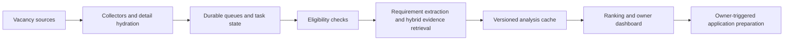

# Career Agent

A Python and AWS engineering project for vacancy discovery, evidence-based job
matching and owner-controlled application preparation. Built by
[Behrad Zabihi](https://github.com/8ehrad).

**Status:** the dedicated backend was retired on 14 October 2026. This repository
is a public portfolio snapshot, with a fresh history and invented candidate data.
It does not provide a live job-search service.

## What the project demonstrates

- Asynchronous collection and advert hydration with Lambda, SQS, DynamoDB and S3.
- Deterministic eligibility checks before model inference and ranking.
- Requirement extraction, BM25 plus dense retrieval, cited evidence assessment
  and versioned result caching. Rich matching was deployed in September 2026.
- Atomic model budgets, durable tasks, leases, retries, reconciliation and dead-letter queues.
- Authenticated APIs, pagination and pipeline observability.
- DOCX application rendering, source checks and a locally implemented asynchronous
  preparation path. The richer writing path remained experimental and undeployed.
- Historical Terraform templates, with account-specific configuration removed
  and schedules disabled in this snapshot.

## Explore locally

Use Python 3.12 or later in a virtual environment:

```sh
python -m pip install -r requirements-lambda.txt
PYTHONPATH=src python -m unittest discover -s tests -v
python scripts/run_fixture_pipeline.py
```

The fixture pipeline uses synthetic adverts, in-memory storage, rule-based
analysis and an in-memory email collector. It requires no AWS credentials,
model calls or real email delivery. The candidate example is entirely invented;
its numeric thresholds demonstrate configuration, not the author's preferences.

## Architecture



`src/career_agent/` contains the pipeline, storage adapters, matching and writing
modules. `tests/` retains tests that can operate with synthetic data and mocks.
`infra/` records the historical infrastructure design; it is not a ready-to-apply
recovery workspace. The former remote state backend is deliberately absent.

## Scope and limitations

Real profiles, employment evidence, salary and search preferences, CV documents,
certificates, adverts exported from the private database, inference receipts,
embeddings, deployment archives, credentials, account configuration and private
Git history are excluded. Tests depending on those private artifacts are also
excluded; this snapshot does not reproduce the private fit or writing benchmarks.
One historical backlog-priority regression is retained as an expected failure,
so it remains visible without presenting the project as fully defect-free.
Qualification scores were provisional and not calibrated hiring probabilities.
Application submission remained under human control.

See [third-party notices](THIRD_PARTY_NOTICES.md). No license grant has been added
on the author's behalf.
