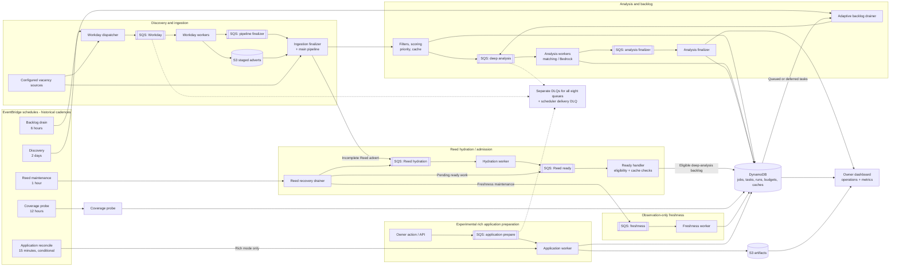
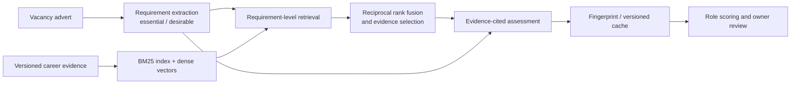

# Career Agent

**An AWS-based vacancy discovery and AI matching system with scheduled ingestion, eight specialised SQS queues, evidence-grounded retrieval, budget-aware inference and durable recovery workflows.**

Career Agent began as a personal job-search project. Its main engineering challenge became orchestration: collecting vacancies from multiple ATS sources, fetching incomplete descriptions, deciding which roles justify model inference, respecting usage budgets and recovering interrupted work without losing results. An authenticated owner dashboard surfaces the recommendations and operational state.

> **Project status:** The dedicated backend was retired on **14 October 2026**. This is a privacy-safe public engineering snapshot, **not a live job-search service**. The candidate data is invented and the Git history is fresh. All recurring schedules are **disabled by default** in the public Terraform templates.

## Engineering highlights

- **Scheduled control plane:** EventBridge Scheduler definitions for discovery, analysis-backlog draining, source-coverage sampling, Reed recovery and conditional application reconciliation.
- **Eight specialised queues:** Workday collection, pipeline finalization, Reed hydration, Reed ready admission, deep analysis, analysis finalization, vacancy freshness and application preparation. Dedicated DLQs isolate failures.
- **Durable asynchronous work:** Lambda workers, persisted runs/tasks, leases, capped retries, deadline-aware finalizers and recovery loops.
- **Budget-aware matcher:** Call, token and estimated-spend guardrails; adaptive backlog dispatch considers priority, queue age, fairness, throughput and remaining capacity.
- **Evidence-grounded AI:** Structured requirement extraction, BM25 plus dense retrieval, reciprocal rank fusion and assessments tied to source evidence. **Rich matching was deployed in September 2026.**
- **Human-controlled applications:** DOCX preparation and experimental rich writing, without automatically submitting applications.

## Operational architecture

The original design uses several coordinated workflows, not one monolithic agent. The diagram below shows **all eight SQS workload queues**, their principal producers/consumers and the five historical scheduler definitions.



**How to read this:** Double-bordered rectangles represent SQS queues. Dashed links are illustrative of the DLQ arrangement, which applies to *every* workload queue, not just the three shown connected to the shared note. This is a **logical architecture**: the snapshot does not have running schedules or a deployed rich-writing service. See [infra/main.tf](infra/main.tf) and [infra/freshness.tf](infra/freshness.tf) for exact AWS wiring.

## Scheduled jobs

The Terraform configuration defines these EventBridge Scheduler intervals. The default [schedule_state](infra/variables.tf) is `DISABLED`, so the cadences describe historical configuration, not jobs running today.

| Job | Configured interval | Responsibility |
| --- | --- | --- |
| **Vacancy discovery** | Every **2 days** | [Workday dispatcher](src/career_agent/handlers/workday_dispatcher.py) starts a persisted ingestion run and fans out source collection |
| **Analysis backlog drain** | Every **6 hours** | [Backlog drainer](src/career_agent/handlers/backlog_drainer.py) reselects eligible queued/timed-out jobs against the daily inference budget |
| **Coverage probe** | Every **12 hours** | [Coverage probe](src/career_agent/handlers/coverage_probe.py) checks pending coverage samples against fresh source collection |
| **Reed hydration maintenance** | Every **1 hour** | [Reed drainer](src/career_agent/handlers/reed_hydration_drainer.py) recovers stale, pending or expired-lease hydration tasks; also maintains optional freshness checks |
| **Application recovery** | Every **15 minutes** | [Application worker](src/career_agent/handlers/application_prepare_worker.py) requeues stalled preparations; **conditional on rich application mode and enabled schedules** |

Scheduler deliveries have bounded retries and a scheduler DLQ. The discovery dispatcher uses scheduled timestamps as stable run IDs for idempotent invocations.

## Workload queues

The infrastructure defines **eight separate SQS workload queues**, each with a dedicated DLQ and consumer Lambda. Event mappings use partial batch failure reporting; concurrency caps vary by worker.

| SQS queue | Consumer | Responsibility |
| --- | --- | --- |
| **Workday** | [workday_worker.py](src/career_agent/handlers/workday_worker.py) | Parallel ATS collection; stage fetched adverts in S3 |
| **Pipeline finalizer** | [scheduled.py](src/career_agent/handlers/scheduled.py) and [workday_finalize.py](src/career_agent/handlers/workday_finalize.py) | Wait for ingestion fan-out; merge staged data and resume the primary pipeline |
| **Reed hydration** | [reed_hydration_worker.py](src/career_agent/handlers/reed_hydration_worker.py) | Retrieve missing advert details with bounded attempts and request budgets |
| **Reed hydration ready** | [reed_hydration_ready.py](src/career_agent/handlers/reed_hydration_ready.py) | Recheck details, eligibility and cache status before entering the deep-analysis backlog |
| **Deep analysis** | [deep_analysis_worker.py](src/career_agent/handlers/deep_analysis_worker.py) | Perform budget-guarded AI analysis and persist task results |
| **Analysis finalizer** | [deep_analysis_finalize.py](src/career_agent/handlers/deep_analysis_finalize.py) | Wait for analysis tasks or deadlines and complete discovery or backlog-drain runs |
| **Freshness** | [freshness_worker.py](src/career_agent/handlers/freshness_worker.py) | Observation-only source freshness rechecks; not an eligibility enforcement system |
| **Application prepare** | [application_prepare_worker.py](src/career_agent/handlers/application_prepare_worker.py) | Owner-requested rich writing and task reconciliation; experimental and **undeployed** |

### Discovery: fan-out followed by coordinated finalization

The [Workday dispatcher](src/career_agent/handlers/workday_dispatcher.py) creates a persistent ingestion run and one work item per active configured Workday source. Workers update task state and stage documents in **S3**. The **pipeline-finalizer queue** checks whether all workers are finished; if not, it schedules another check until completion or a deadline.

Finalization combines staged Workday results with other configured sources using the [main pipeline](src/career_agent/pipeline.py). The resulting vacancies are normalised, filtered, scored and selected for deeper assessment. Importantly, **collection does not block on a single long-running Lambda**.

### Reed: separate hydration and ready admission

Reed listings may be discovered without their complete advert text. The system persists hydration tasks and dispatches them through the **Reed hydration queue**.

Hydration workers retrieve and persist full details, then send a signal to a **separate Reed ready queue**. The ready handler revalidates the advert, checks hard filters and closure state, looks for a compatible cached analysis and admits qualifying new work into the durable backlog.

The **hourly Reed maintenance schedule** re-dispatches eligible pending/stale/expired-lease hydration tasks and missed ready messages. This prevents incomplete descriptions being silently treated as fully assessed opportunities. Source handlers: [hydration worker](src/career_agent/handlers/reed_hydration_worker.py), [ready admission](src/career_agent/handlers/reed_hydration_ready.py), [recovery drainer](src/career_agent/handlers/reed_hydration_drainer.py).

### Budget-aware matching and the six-hour backlog drainer

This is a control loop, **not merely an SQS retry**. [backlog_drainer.py](src/career_agent/handlers/backlog_drainer.py) scans queued and timed-out analysis tasks in DynamoDB, excludes closed or not-yet-hydrated vacancies and selects work based on:

- remaining **daily model-call, token and estimated-cost budgets**
- task priority and waiting age
- source diversity and urgency
- previous drain throughput and adaptive batch size
- throttling cooldowns and protected discovery capacity

Selected jobs are atomically marked for dispatch, sent through the **deep-analysis queue**, and tracked in a durable backlog-drain run. The **analysis-finalizer queue** handles completion separately from ordinary discovery runs.

The [analysis budget policy](src/career_agent/analysis_budget.py) includes the following *configurable defaults*, not throughput claims:

| Control | Source default |
| --- | ---: |
| Daily model-call ceiling | 75 calls |
| Daily input token ceiling | 225,000 |
| Daily output token ceiling | 90,000 |
| Estimated daily model spend ceiling | $1.75 |
| Adaptive backlog target | 50–75 calls/day |
| Maximum drain batch | 25 tasks |
| Slots protected for discovery when reserved | Up to 25 |
| Oldest backlog age SLO | 72 hours |

Fresh model requests reserve budget capacity before execution, with usage reconciliation and deferral when limits are reached. The [analysis worker](src/career_agent/handlers/deep_analysis_worker.py) and [rich matching adapter](src/career_agent/rich_matching.py) support resumable state and budget-aware continuation.

### Inside the richer matcher

The matching system evaluates **specific job requirements against specific career evidence**, rather than asking a model to assign an unsupported overall fit score.



- [requirement_extraction.py](src/career_agent/requirement_extraction.py) creates structured requirement data and distinguishes essential from desirable criteria.
- [hybrid_retrieval.py](src/career_agent/hybrid_retrieval.py) combines **BM25, semantic similarity and reciprocal rank fusion** over indexed, traceable evidence.
- [accuracy_assessment.py](src/career_agent/accuracy_assessment.py) constrains judgments to cited evidence and checks model outputs.
- [rich_matching.py](src/career_agent/rich_matching.py) uses staged/checkpointed results so interruptions or budget deferrals do not automatically discard completed model work.
- [analysis_cache.py](src/career_agent/analysis_cache.py) uses job, profile, model and analyser fingerprints to avoid unnecessary repeat analysis.

The richer matching path was **deployed in September 2026**. The private profile corpus and historical fit benchmarks are intentionally omitted from this public snapshot.

### Freshness, recovery and operations

[Freshness monitoring](src/career_agent/freshness.py) is **observation-only**, independent of fit scoring and application state. The hourly Reed maintenance handler can recover due observation tasks; the freshness SQS worker records source outcomes. The [freshness_mode](infra/freshness.tf) setting supports `off` and `observe`, defaulting to **off**. It does not automatically disqualify vacancies.

Other reliability features include durable run/task identities, leases, worker retries, delayed finalizer checks, SQS DLQs, CloudWatch metrics and alarms, and SNS alerts. The authenticated owner API exposes [ingestion status, pipeline runs, backlog, throughput, coverage and source health](src/career_agent/handlers/api.py). [operations.py](src/career_agent/operations.py) provides read-only operational views; dashboard hosting, JWT access and AWS infrastructure are represented in [Terraform](infra/main.tf).

### Owner-triggered application preparation

The owner can request application documents, but **submission remains a human decision**. The repository includes [document rendering](src/career_agent/cv_layout.py), [factual/source guards](src/career_agent/application_writing.py) and an [asynchronous application worker](src/career_agent/handlers/application_prepare_worker.py). That worker can resume queued work, claim a lease, generate artifacts and handle failures.

**The richer writing and asynchronous preparation path was implemented and tested locally but not deployed.** Its SQS mapping and 15-minute recovery schedule are conditional on the `rich` application mode, which the public template does not enable by default.

## Historical status of major components

| Capability | Status |
| --- | --- |
| Multi-source collection, Workday fan-out and pipeline finalization | Part of the historical system |
| Reed hydration, ready admission and recovery | Implemented in the historical system |
| Deterministic filtering, durable backlog and scheduled draining | Implemented in the historical system |
| **Rich evidence-grounded matching** | **Deployed September 2026** |
| Owner dashboard, operational metrics and alerts | Part of the historical system |
| Freshness observations | Optional, **off by default** in public Terraform |
| Rich asynchronous CV/letter writing and application reconciliation | **Local experimental implementation, undeployed** |
| Backend service | **Retired 14 October 2026** |

## Tech stack

| Layer | Technologies |
| --- | --- |
| Language and testing | Python 3.12+, `unittest`, local fixtures and mocks, GitHub Actions |
| Scheduling and orchestration | EventBridge Scheduler, AWS Lambda, SQS and dead-letter queues |
| Storage | DynamoDB, S3 |
| AI / retrieval | Amazon Bedrock, BM25, dense embeddings, reciprocal rank fusion, model-response caching |
| API and authentication | API Gateway, Lambda HTTP handlers, Cognito JWT authentication |
| Dashboard | S3, CloudFront |
| Operations | CloudWatch, SNS alerts, pipeline metrics and source diagnostics |
| Document generation | `python-docx`, evidence-backed CV and cover-letter preparation |
| Infrastructure | Terraform |

## Explore locally

The public version includes a **synthetic offline pipeline** using invented adverts and a fictional candidate, in-memory storage, rule-based analysis and an in-memory email collector. It does **not** call AWS, invoke models or deliver email.

Use Python 3.12 or later:

```bash
python -m pip install -r requirements-lambda.txt
PYTHONPATH=src python -m unittest discover -s tests -v
python scripts/run_fixture_pipeline.py
```

The offline tests cover pipeline behaviour, caches, async dispatch and recovery, API handling and application preparation. One known backlog-priority regression is explicitly retained as an **expected failure**. The synthetic demo does not reproduce historical inference evaluations, the private evidence corpus or the retired cloud runtime.

## Repository guide

| Location | Focus |
| --- | --- |
| [infra/main.tf](infra/main.tf) | Scheduler jobs, SQS, Lambdas, IAM, dashboard/API and alarms |
| [infra/freshness.tf](infra/freshness.tf) | Observation-only freshness resources |
| [src/career_agent/handlers/](src/career_agent/handlers/) | Workers, drainers, finalizers and API handlers |
| [src/career_agent/pipeline.py](src/career_agent/pipeline.py) | Main ingestion, filtering and recommendation pipeline |
| [src/career_agent/analysis_budget.py](src/career_agent/analysis_budget.py) | Inference budgets and adaptive backlog policy |
| [src/career_agent/async_analysis.py](src/career_agent/async_analysis.py) | Durable SQS task dispatch and finalizer scheduling |
| [src/career_agent/hybrid_retrieval.py](src/career_agent/hybrid_retrieval.py) | BM25, dense retrieval and reciprocal rank fusion |
| [src/career_agent/rich_matching.py](src/career_agent/rich_matching.py) | Rich matching and checkpointed inference stages |
| [src/career_agent/application_writing.py](src/career_agent/application_writing.py) | Experimental writing and source-based factual checks |
| [tests/](tests/) | Synthetic offline test suite |
| [scripts/run_fixture_pipeline.py](scripts/run_fixture_pipeline.py) | Cloud-free demonstration |
| [.github/workflows/ci.yml](.github/workflows/ci.yml) | Offline checks on main |

## Public snapshot and privacy

This snapshot excludes real candidate profiles, employment evidence, salary/search preferences, CVs and certificates, private job/database exports, embeddings, inference receipts, account configuration, credentials, state files, deployment artifacts and private Git history. The example profile is **entirely invented**; its thresholds are not my actual job-search settings.

Tests dependent on private assets are omitted, and the repository cannot reproduce the private matching or writing benchmarks. Historical qualification scores were provisional ranking signals, **not calibrated hiring probabilities**.

Terraform remains as an **architecture record**, not a ready-to-apply recovery workspace. Schedules are disabled, account-specific inputs are absent and the former remote state backend has been removed. Nothing here authorises deploying cloud resources or making live model calls.

See [third-party notices](THIRD_PARTY_NOTICES.md). No licence grant has been added on the author's behalf.
