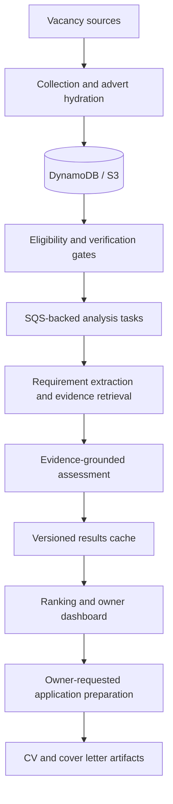

# Career Agent

**An AWS-based job-discovery and matching system with evidence-grounded AI assessment, asynchronous processing and owner-controlled application preparation.**

Career Agent started as a way to bring vacancy discovery, fit assessment and application preparation into one workflow. The more interesting challenge became the engineering: collecting incomplete listings from different sources, deciding which jobs merit deeper analysis, keeping LLM spending predictable, and recovering interrupted work without losing progress.

**Project status:** The dedicated backend was retired on **14 October 2026**. This repository is a **public engineering portfolio snapshot**, not a live job-search service. It contains a fresh Git history and **invented candidate data** rather than personal records or the original private database.

## What the system does

- **Discover and enrich vacancies.** Collect listings from multiple sources, normalise details and retrieve fuller adverts where available.
- **Filter before inference.** Apply deterministic eligibility and salary-verification checks before prioritising more expensive model analysis.
- **Assess role fit against evidence.** Extract requirements and retrieve relevant career evidence using BM25 plus dense retrieval; the richer matching path assesses requirements against cited source claims.
- **Schedule reliable analysis.** Use Lambda, SQS, DynamoDB and S3 for durable jobs, versioned results, retry/recovery workflows and cached assessments.
- **Control inference spending.** Reserve model-call, token and cost capacity before fresh requests, with budget-aware deferral and backlog processing.
- **Keep applications under human control.** Generate application materials for review rather than submitting applications automatically.

Rich matching was **deployed in September 2026**. More elaborate CV/letter-writing and asynchronous preparation paths were implemented and tested locally but **remained experimental and undeployed**.

## Architecture

The diagram represents the overall design, including historical deployment components and an optional experimental application-preparation path.



The application-preparation and document-writing capabilities above are part of the broader design; the richer writing path was **not deployed**.

## Tech stack

| Area | Technologies |
| --- | --- |
| Language and testing | Python 3.12+, `unittest`, local fixtures and mocks |
| Cloud and orchestration | AWS Lambda, SQS, EventBridge Scheduler, DynamoDB, S3 |
| AI and search | Amazon Bedrock, requirement extraction, BM25, dense retrieval, reciprocal rank fusion |
| Backend and access | Lambda API handlers, Amazon Cognito, owner-scoped endpoints |
| Observability and delivery | CloudWatch, task/run metrics, SES/SNS digest integrations |
| Frontend and infrastructure | S3/CloudFront dashboard hosting, Terraform |
| Documents | `python-docx`, evidence-grounded CV and application-pack generation |

These technologies span the historical system and repository source; the retired deployment cannot be used as a hosted demo.

## Engineering decisions

### Prioritise reliability over a single long-running agent

Collection, description hydration and deeper analysis are separate tasks. SQS queues and persisted task state let the pipeline resume or reconcile work after interruptions. The implementation includes leases, bounded retries, dead-letter queues and backlog processing.

See [async_analysis.py](src/career_agent/async_analysis.py), [deep_analysis_worker.py](src/career_agent/handlers/deep_analysis_worker.py) and [operations.py](src/career_agent/operations.py).

### Spend model budget where it matters

Deterministic filters and prioritisation run before LLM analysis. Fresh model requests are gated by atomic daily budgets for **calls, tokens and estimated cost**. The system can defer work when capacity is exhausted rather than treating every collected vacancy as an immediate inference request.

See [analysis_budget.py](src/career_agent/analysis_budget.py) and [analysis_cache.py](src/career_agent/analysis_cache.py).

### Ground matching in source evidence

Rather than matching a vacancy to a generic skills list, the rich path extracts job requirements, searches a profile-scoped evidence corpus with **BM25 and dense retrieval**, combines rankings, and assesses requirements using traceable evidence identifiers. Profile, model and input fingerprints also support versioned result reuse.

See [requirement_extraction.py](src/career_agent/requirement_extraction.py), [hybrid_retrieval.py](src/career_agent/hybrid_retrieval.py) and [rich_matching.py](src/career_agent/rich_matching.py).

### Separate application assistance from application submission

The owner can initiate document preparation. The repository includes DOCX rendering, factual/source checks and a locally implemented asynchronous preparation workflow. The richer writing pipeline was experimental, and **application submission remained a human decision**.

See [application_writing.py](src/career_agent/application_writing.py), [cv_layout.py](src/career_agent/cv_layout.py) and [application_prepare_worker.py](src/career_agent/handlers/application_prepare_worker.py).

## Explore the public version locally

The repository includes a self-contained fixture demonstration using synthetic vacancies, in-memory persistence, a rule-based analyser and a fake email collector. **It does not require AWS credentials, model inference or real email delivery.**

Requires Python 3.12 or later:

```bash
python -m pip install -r requirements-lambda.txt
PYTHONPATH=src python -m unittest discover -s tests -v
python scripts/run_fixture_pipeline.py
```

The fixture runner prints a report and example job results. Unit tests cover pipeline behaviour, asynchronous analysis, caching, API handling, failure recovery and application preparation. One historical backlog-priority regression is retained as an **expected failure** to make that limitation visible.

This demonstration does **not** reproduce the retired cloud deployment, private matching benchmarks or real candidate data.

## Repository guide

| Path | Contents |
| --- | --- |
| [src/career_agent/](src/career_agent/) | Collection, enrichment, matching, storage, scoring and writing modules |
| [src/career_agent/handlers/](src/career_agent/handlers/) | Lambda/API handlers for collection, analysis, recovery and application preparation |
| [tests/](tests/) | Synthetic fixtures and offline tests |
| [scripts/run_fixture_pipeline.py](scripts/run_fixture_pipeline.py) | Local end-to-end demonstration without cloud calls |
| [infra/](infra/) | Historical Terraform infrastructure design |
| [data/](data/) | Synthetic example profile and source configuration |
| [.github/workflows/ci.yml](.github/workflows/ci.yml) | Offline checks on the repository's main branch |

## Scope of the public snapshot

The source tree is intended for engineering review, not recovery of the former live service.

- **Privacy:** Real profiles, employment evidence, salaries, job preferences, CVs, certificates, private database exports, embeddings, inference receipts, account configuration, secrets, deployment archives and original private Git history are excluded. The candidate example is invented; its numeric thresholds are illustrative configuration, not my preferences.
- **Testing:** Fixture and mock-based tests can run offline. Tests requiring the omitted private artifacts are excluded, and this snapshot does not reproduce private fit or writing benchmarks.
- **Infrastructure:** Terraform files document the historical design. Schedules are disabled, account-specific values and the former remote state backend are absent, and these files are **not ready-to-apply deployment instructions**.
- **Model outputs:** Historical qualification scores were provisional ranking signals, not calibrated hiring probabilities.

## Next improvements

- Create a sanitised demonstration of the evidence-to-requirement matching flow.
- Add explicit example failure/retry traces for an asynchronous analysis task.
- Extend offline tests around backlog priority and incomplete advert handling.
- Build a small visual walkthrough of the dashboard using synthetic data.

See [third-party notices](THIRD_PARTY_NOTICES.md). No license grant has been added on my behalf.
